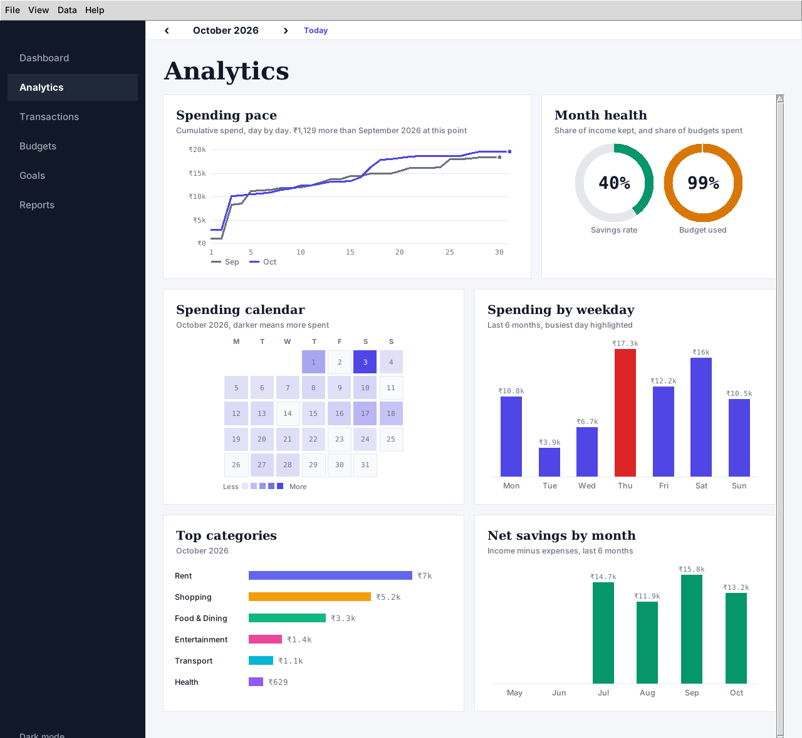

# FinTrack - Personal Finance & Budget Planner

A desktop application built with **Python 3 + Tkinter** and **SQLite** for the APP subject project.
Record income and expenses, set monthly budgets, follow savings goals, and read reports - all stored
locally, no internet or third-party packages needed.


## Features

| Screen | What it does |
|---|---|
| **Dashboard** | Net balance, monthly income / expenses / savings rate (with change vs last month), 6-month income-vs-expense bar chart, category donut chart, recent transactions, budget status |
| **Analytics** | Spending pace line chart (this month vs last), savings-rate and budget-used rings, spending calendar heatmap, spending by weekday, top categories, net savings by month |
| **Transactions** | Add / edit / delete with validation, live search, filter by type and category, "this month only" checkbox, coloured rows |
| **Budgets** | Monthly limit per category, progress bars that turn amber at 80% and red when exceeded, "over by" / "left" messages |
| **Goals** | Savings goals with progress, deadline countdown, suggested monthly saving and an Add-funds dialog |
| **Reports** | Top category, biggest expense, average daily spend, projected month-end spend, breakdown vs budget, **CSV export** |
| **App-wide** | Month navigator, light/dark theme (remembered), menu bar, keyboard shortcuts, quit confirmation, demo data loader |

Keyboard shortcuts: `Ctrl+N` new transaction, `Ctrl+1..6` switch screen, `Ctrl+E` export, `Ctrl+T` theme, `F5` refresh, `Ctrl+Q` quit.

## Web edition (Vercel)

Tkinter is a desktop toolkit and cannot run on Vercel, so the repo also contains `public/index.html`,
a dependency-free web version of the same planner (same five screens, dark mode, CSV export, data
saved in the browser's localStorage). `vercel.json` points Vercel at the `public/` folder.
The graded project is the Tkinter app; the web edition is a live demo of the same design.

## Run it (desktop app)

```bash
python main.py
```

Requires Python 3.10+ with Tkinter (included with the python.org installers for Windows/macOS;
on Ubuntu/Debian: `sudo apt install python3-tk`). The first launch is empty - use
**Data -> Load demo data** to see the app with sample records.

## Project structure

```
main.py            entry point
app.py             main window: sidebar, month selector, menu, shortcuts, theme switching
db.py              SQLite data layer (transactions, budgets, goals, settings, demo data)
services.py        pure helpers: money formatting, validation, month maths, budget status
exporter.py        CSV export
theme.py           colour palettes, three-font system (serif headings, sans text, monospace figures), ttk styling
widgets.py         Card, StatCard, ProgressBar, BarChart, DonutChart, LineChart, ColumnChart, HBarChart,
                   CalendarHeatmap, RingGauge, ScrollFrame
pages/             one class per screen (dashboard, analytics, transactions, budgets, goals, reports)
tests/             unit tests (data layer, helpers, export) + headless GUI smoke tests
screenshots/       images used in this README
```

## Tkinter concepts used (from the NeuralNine "Tkinter Beginner Course")

Main window, title and geometry (`App(tk.Tk)`) - Labels, Entry and Buttons with padding - `grid`,
`pack` and `place` layouts - GUI built with classes - Checkbutton (`This month only`) - buttons linked
to functions - message boxes (`showerror`, `askyesno`) - keyboard shortcuts (`bind_all`) - handling
window closure (`WM_DELETE_WINDOW`) - application menus (`tk.Menu`). Beyond the course it also uses
`ttk` themed widgets and styles, `Treeview`, `Combobox` and custom `Canvas` drawing for the charts.

## Tests

```bash
python -m unittest discover -s tests          # GUI tests are skipped if no display
xvfb-run -a python -m unittest discover -s tests   # headless Linux
```

## Screenshots

| Analytics | Transactions |
|---|---|
|  |  |
| **Budgets** | **Goals** |
|  |  |
| **Reports** | |
|  | |

Dark mode:


Viva preparation notes: see [VIVA.md](VIVA.md).
