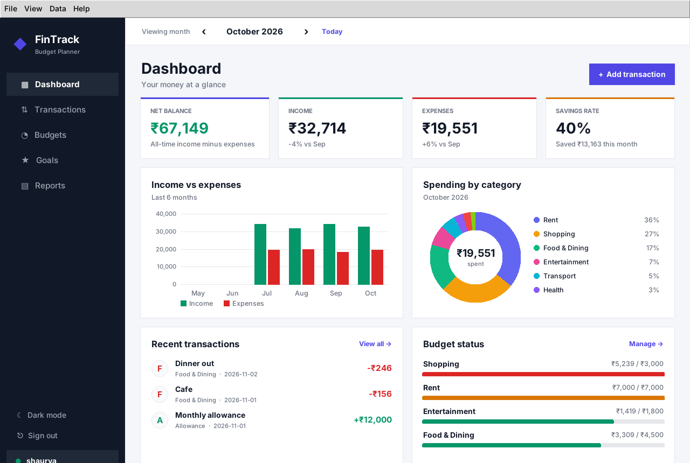
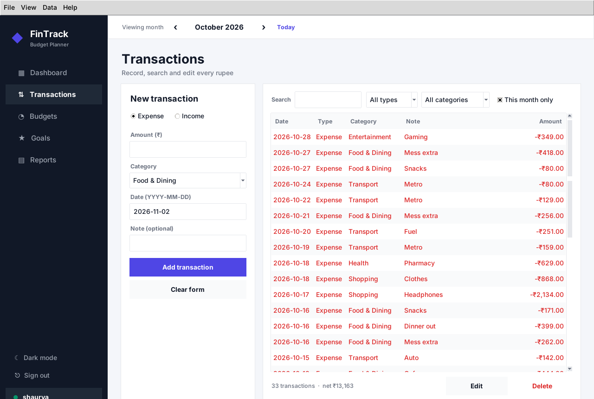
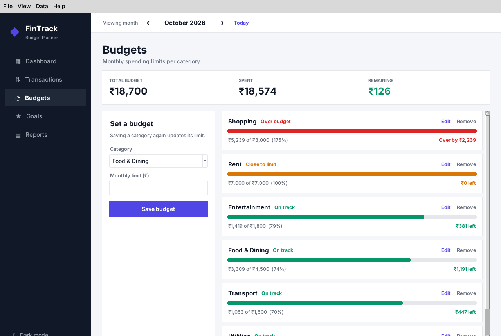
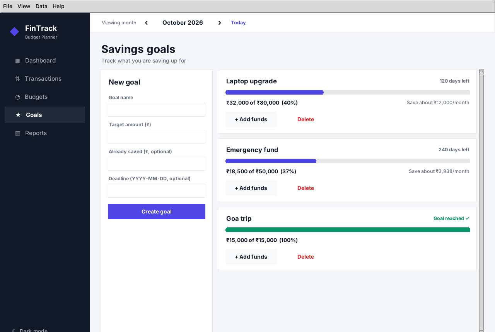
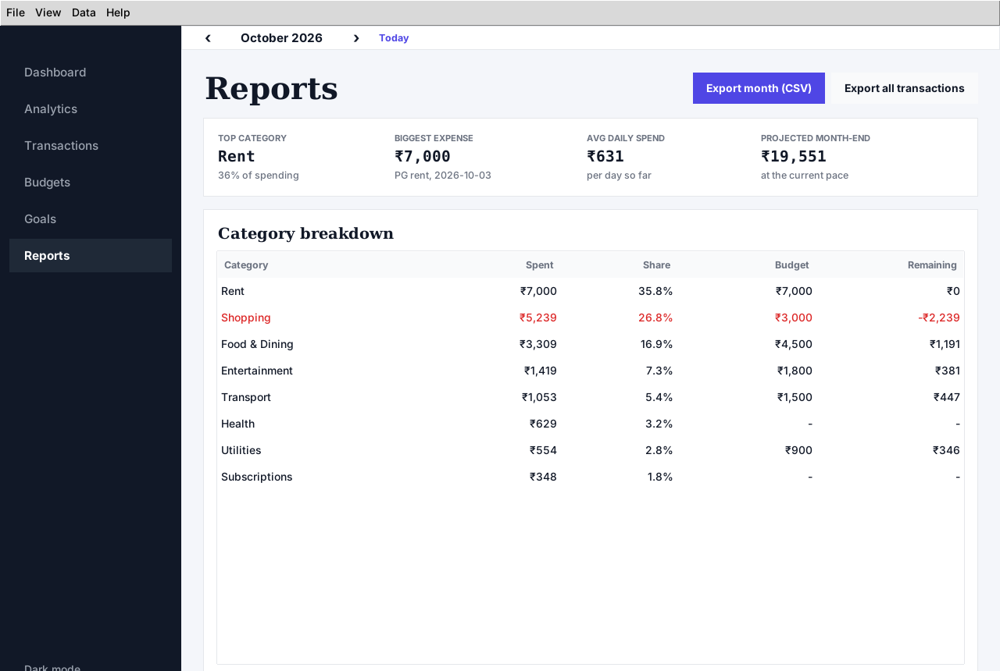
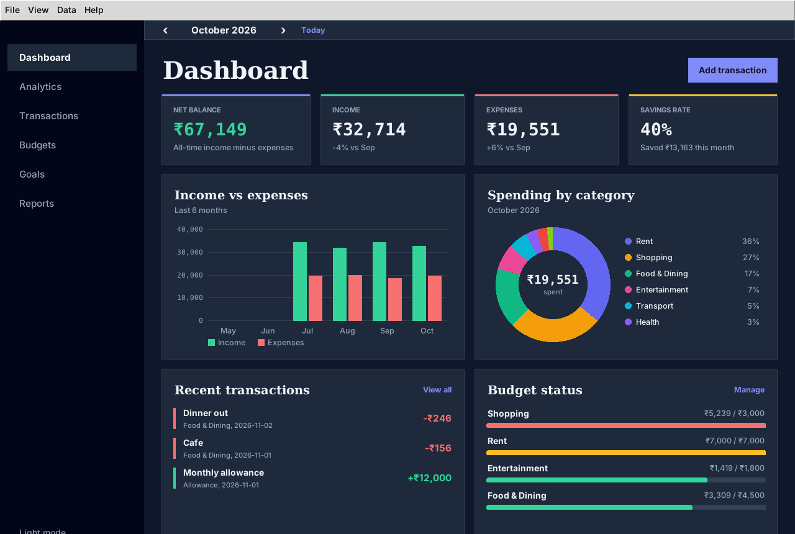

# FinTrack - Personal Finance & Budget Planner

A desktop application built with **Python 3 + Tkinter** and **SQLite** for the APP subject project.
Record income and expenses, set monthly budgets, follow savings goals, and read reports - all stored
locally, no internet or third-party packages needed.



## Features

| Screen | What it does |
|---|---|
| **Dashboard** | Net balance, monthly income / expenses / savings rate (with change vs last month), 6-month income-vs-expense bar chart, category donut chart, recent transactions, budget status |
| **Transactions** | Add / edit / delete with validation, live search, filter by type and category, "this month only" checkbox, coloured rows |
| **Budgets** | Monthly limit per category, progress bars that turn amber at 80% and red when exceeded, "over by" / "left" messages |
| **Goals** | Savings goals with progress, deadline countdown, suggested monthly saving and an Add-funds dialog |
| **Reports** | Top category, biggest expense, average daily spend, projected month-end spend, breakdown vs budget, **CSV export** |
| **Accounts** | Sign-in / create-account screen, salted password hashing, per-user data, sign-out, login lockout after repeated wrong passwords |
| **App-wide** | Month navigator, light/dark theme (remembered), menu bar, keyboard shortcuts, quit confirmation, demo data loader |

Keyboard shortcuts: `Ctrl+N` new transaction, `Ctrl+1..5` switch screen, `Ctrl+E` export, `Ctrl+T` theme, `F5` refresh, `Ctrl+Q` quit.

## Web edition (Vercel)

Tkinter is a desktop toolkit and cannot run on Vercel, so the repo also contains `public/index.html`,
a dependency-free web version of the same planner (same five screens, dark mode, CSV export, data
saved in the browser's localStorage). `vercel.json` points Vercel at the `public/` folder.
The graded project is the Tkinter app; the web edition is a live demo of the same design.

## Run it (desktop app)

```bash
python main.py
```

Requires Python 3.10+ with Tkinter (included with the python.org installers for Windows/macOS;
on Ubuntu/Debian: `sudo apt install python3-tk`). On first launch choose **Create an account**, then use
**Data -> Load demo data** to see the app with sample records.

## Project structure

```
main.py            entry point
app.py             main window: sidebar, month selector, menu, shortcuts, theme switching
auth.py            password hashing, validation, login rate limiting (AuthService)
login.py           sign-in / create-account screen
db.py              SQLite data layer (users, transactions, budgets, goals, settings, demo data)
services.py        pure helpers: money formatting, validation, month maths, budget status
exporter.py        CSV export
theme.py           colour palettes, fonts, ttk styling (light + dark)
widgets.py         Card, StatCard, ProgressBar, BarChart, DonutChart, ScrollFrame
pages/             one class per screen (dashboard, transactions, budgets, goals, reports)
tests/             unit tests (data layer, helpers, export) + headless GUI smoke tests
screenshots/       images used in this README
```

## Tkinter concepts used (from the NeuralNine "Tkinter Beginner Course")

Main window, title and geometry (`App(tk.Tk)`) - Labels, Entry and Buttons with padding - `grid`,
`pack` and `place` layouts - GUI built with classes - Checkbutton (`This month only`) - buttons linked
to functions - message boxes (`showerror`, `askyesno`) - keyboard shortcuts (`bind_all`) - handling
window closure (`WM_DELETE_WINDOW`) - application menus (`tk.Menu`). Beyond the course it also uses
`ttk` themed widgets and styles, `Treeview`, `Combobox` and custom `Canvas` drawing for the charts.

## Accounts, database and security

* **Database connection:** `sqlite3` (Python's DB-API 2.0, the counterpart of JDBC). `sqlite3.connect()` ~
  `DriverManager.getConnection()`, `conn.execute()` ~ `PreparedStatement` with `?` placeholders,
  `with conn:` ~ a transaction that commits or rolls back, `row_factory` ~ `ResultSet` access by column name.
* **Per-user data:** every table row has a `user_id`; every query filters on it, so accounts are isolated.
  Databases created before accounts existed are upgraded automatically and adopted by the first user.
* **Passwords:** never stored - only a random-salted PBKDF2-HMAC-SHA256 hash (600,000 iterations),
  compared in constant time.
* **Rate limiting:** 5 wrong passwords lock that username for 60 seconds. The counter is stored in the
  database, so closing and reopening the app does not reset it. Error messages are generic so usernames
  cannot be guessed.

## Tests

```bash
python -m unittest discover -s tests          # GUI tests are skipped if no display
xvfb-run -a python -m unittest discover -s tests   # headless Linux
```

## Screenshots

| Transactions | Budgets |
|---|---|
|  |  |
| **Goals** | **Reports** |
|  |  |

Dark mode:



Viva preparation notes: see [VIVA.md](VIVA.md).
